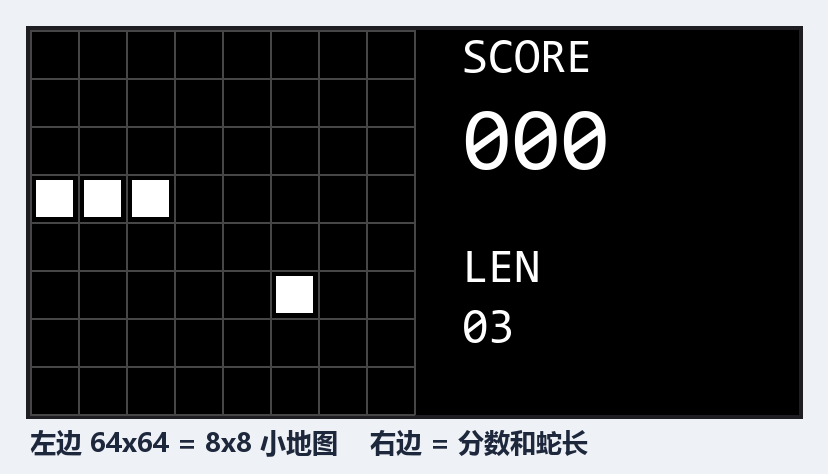
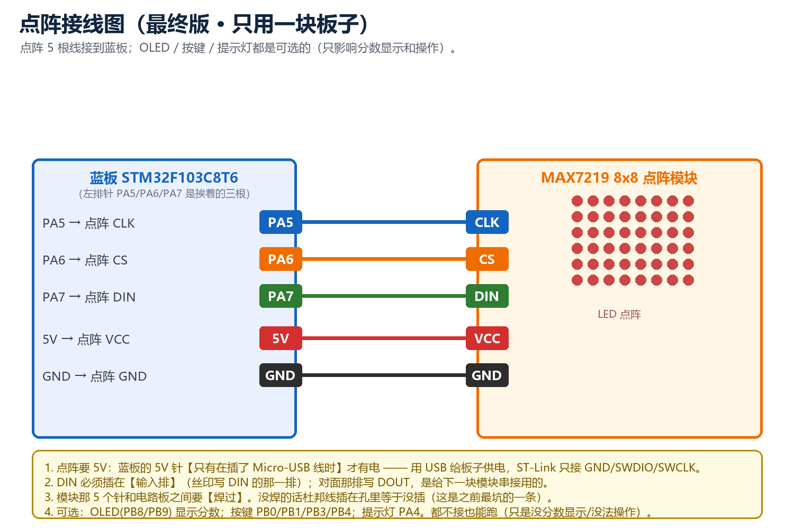
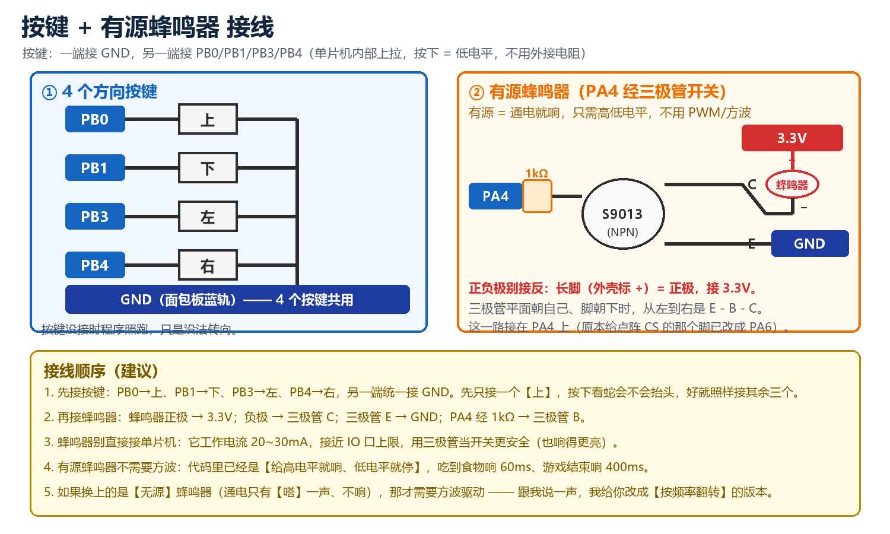
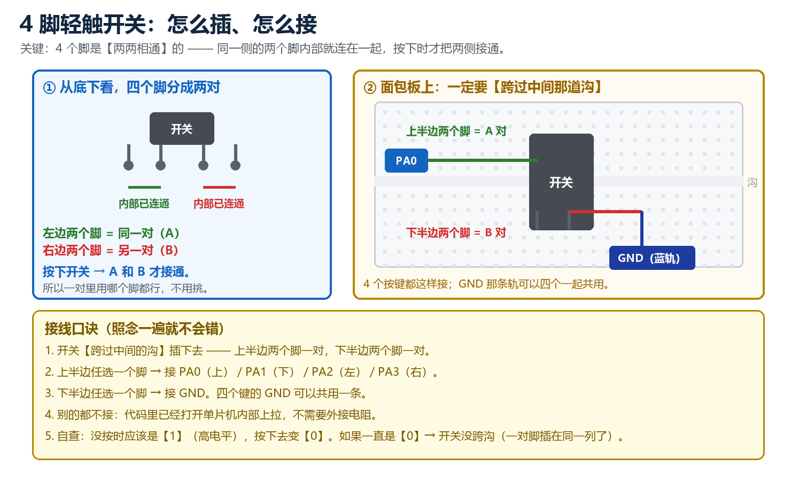

# stm32-snake

基于 **STM32F103C8T6（蓝板）** 的 8×8 贪吃蛇小游戏：4 个轻触按键控制方向，OLED 实时显示棋盘与分数，
蜂鸣器提示音；同时保留了 **MAX7219 8×8 点阵**的驱动与接线（点阵模块因输入排针未焊、接触不良，暂未点亮）。

> 电工基地招新试题作品 · 全流程在面包板上搭建，未使用焊接。

## 效果

8×8 棋盘画在 OLED 上（左：棋盘；右：分数与蛇长）。**蛇头是十字 `+`**、**蛇身是实心方块**、
**食物是空心方框**，一眼可分。



## 1. 硬件清单

| 模块 | 型号 / 说明 |
| --- | --- |
| 主控 | STM32F103C8T6 最小系统板 |
| 显示 | 0.96 寸 I2C OLED（SSD1306，I2C1 **重映射**到 PB8/PB9）——实际作品用它显示 8×8 棋盘 + 分数 |
| 点阵（预留） | MAX7219 8×8 模块：CLK=PA5 / CS=PA6 / DIN=PA7 / VCC=5V |
| 输入 | 5 个轻触按键：上 / 下 / 左 / 右 + 暂停 |
| 提示音 | 蜂鸣器模块（MH-FMD，**低电平触发**）：I/O=PA4 |
| 调试 | ST-Link V2（SWD：SWDIO/SWCLK/GND） |

## 2. 引脚分配

| 功能 | 引脚 | 说明 |
| --- | --- | --- |
| 点阵 MAX7219 | PA5 (CLK)、PA6 (CS)、PA7 (DIN) | 三个脚在左排针上相邻，接线不易错 |
| 方向按键 | PA0 (上)、PA1 (下)、PA2 (左)、PA3 (右) | 另一端接 GND，内部上拉，按下 = 低电平 |
| 暂停键 | PB0 | 也可用「上 + 右」组合键（按住 0.25 s） |
| 蜂鸣器 | PA4 | 低电平触发：拉低就响 |
| OLED | PB8 (SCL)、PB9 (SDA) | I2C1 重映射，**必须** `__HAL_AFIO_REMAP_I2C1_ENABLE()` |
| 板载心跳灯 | PC13 | 每帧翻转一次，用来判断"程序还活着" |
| SWD 下载 | PA13 / PA14 | 不能被其它功能占用 |

## 3. 已实现的功能

- **蛇身数据结构**：环形队列（`x[64]` / `y[64]` + `head` / `tail` / `len`），每步 O(1)，不吃内存；
- **按键消抖**：非阻塞的**时间戳状态机**，电平连续 20 ms 不变才确认，只在"按下"瞬间产生一次事件；
- **防自杀**：一帧只接受一次转向，且禁止与当前方向相反（180°）的输入；
- **食物生成**：xorshift32 伪随机 + **拒绝采样**（不与蛇身重合，最多重抽 500 次保底）；
- **碰撞判定**：撞墙 / 咬到自己（尾节在本帧会移开，不计入）→ Game Over；
- **结算显示**：清屏显示 `GAME OVER` + 本局最终分数，1.2 s 后自动重开；
- **暂停 & 调速**：按住「上 + 右」0.25 s 暂停；暂停中按"上"加速、"下"减速，屏幕上有速度条；
- **心跳灯**：板载小灯每帧翻转，即使 I2C 卡住也能一眼看出 CPU 还在跑。

## 4. 显示刷新率（答辩要点）

- **点阵（MAX7219）**：扫描由芯片内部完成，帧率约 **800 Hz**，8 行轮流点亮 →
  每行约 **156 µs**，占空比 **1/8**；远高于人眼临界频率 50~60 Hz，所以看不见闪。
  若自己用 GPIO 扫描：`f = 1 / (8 × 每行点亮时间) ≥ 100 Hz` → 每行 ≤ **1.25 ms**；
  占空比 1/8 意味着每行瞬时电流是平均值的 8 倍，所以行脚必须用三极管驱动。
- **OLED（SSD1306）**：显存 8 页 × 128 列 = **1024 字节**，一帧
  `1024 × 9 bit ÷ 400 kHz ≈ 23 ms` → 刷新率约 **40 Hz**，完全够用。

## 5. 编译与烧录

开发环境：**VS Code + STM32Cube 扩展**（CMake + Ninja + arm-none-eabi-gcc）。

```bash
# 编译（Debug）
cmake --build build/Debug

# 烧录（ST-Link，SWD 用 100 kHz 更稳：线长或接触不良时不会掉）
STM32_Programmer_CLI -c port=SWD freq=100 mode=UR -e all -w build/Debug/1083.elf -v -rst
```

> 经验：SWD 频率从 4 MHz 降到 **100 kHz** 后，原本"读不到芯片 ID"的连接立刻稳定了。

## 6. 目录结构

```
Core/Src/main.c              全部业务代码（游戏 + MAX7219 / SSD1306 / 按键 / 蜂鸣器 驱动都写在里面）
Core/Src/stm32f1xx_hal_msp.c I2C1 重映射到 PB8/PB9、I2C2（PB10/PB11）分支
Core/Inc/                    头文件（CubeMX 生成）
Drivers/                     ST 官方 HAL 库 + CMSIS
cmake/                       CubeMX 生成的 CMake 构建脚本
1083.ioc                     CubeMX 工程配置
docs/                        接线图
```

## 7. 已知问题

- **MAX7219 点阵未能点亮**：现象是整片全亮、且插拔 CS 时屏幕会闪。
  分析结论：模块**输入排的排针没有焊**，DIN 只能插在裸焊盘孔里，接触不可靠 →
  芯片靠信号线"寄生供电"，内部寄存器状态随机。
  判据：**只接 VCC / GND 时屏幕应全黑**，若仍全亮即说明"电没真正进芯片"。
  下一步：补焊输入排的 5 根针（或更换已焊好排针的模块）。
  因此最终演示改用 OLED 显示 8×8 棋盘（功能与点阵完全一致，同一套游戏逻辑）。

## 8. 接线图

**点阵接线（5 根线）**



**按键与蜂鸣器**



**4 脚轻触开关怎么插**（4 个脚两两相通，必须跨过面包板中间的沟）



更多图见 [`docs/`](docs/) 目录。
